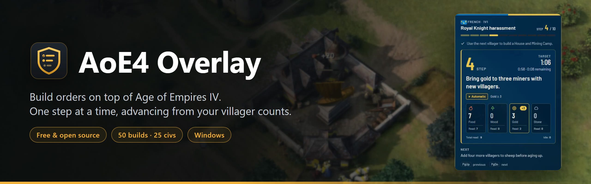
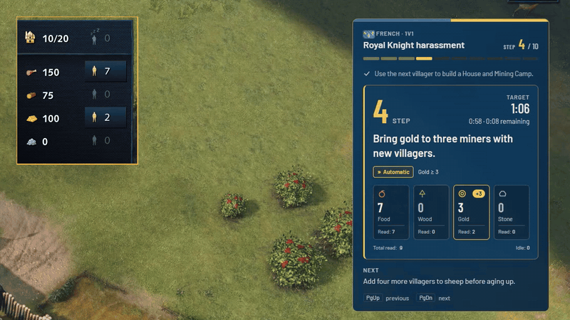
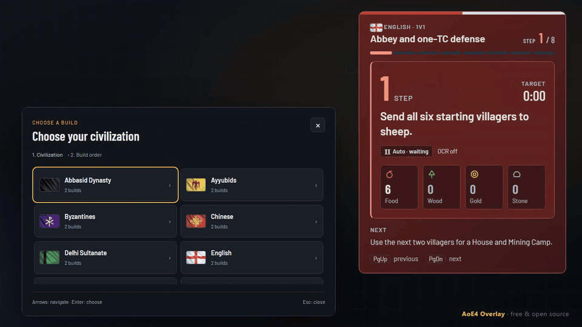
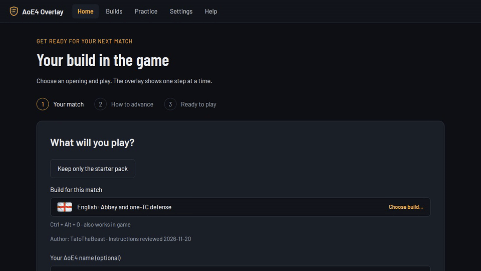

  

  
  
  
  

  <a href="https://github.com/GonzaMato/aoe4-overlay-BO/releases"><b>⬇ Download for Windows</b></a>
  &nbsp;·&nbsp; <a href="docs/quick-start.md">Quick start</a>
  &nbsp;·&nbsp; <a href="docs/user-guide.md">User guide</a>
  &nbsp;·&nbsp; <a href="docs/media/gameplay.mp4">Watch the demo</a>

  

**AoE4 Overlay** puts your build order on top of Age of Empires IV, one step at a time. Press **Page Down** when a step is done, or let it read your villager counters and move on by itself. No account, no browser tab, no alt-tabbing to a guide.

## Features

- **One step at a time.** The current instruction, the villager split to aim for, the target time and what comes next. Clicks pass through to the game.
- **Auto-advance from villager counts** *(beta)*. The app reads the villager numbers on your HUD with Windows OCR and completes resource steps on its own. Buildings and age-ups wait for one key.
- **Pick your build in game.** **Ctrl + Alt + O** opens a picker: choose the civilization by its flag, then the opening.
- **Knows your civ.** Add your AoE4 name (or let the app learn it) and it picks your civilization's build on the loading screen.
- **50 builds included.** Two attributed 1v1 openings for each of the 25 civilizations, in English and Spanish.
- **Bring your own.** Edit any build, write new ones, or import from [AoE4 Guides](https://aoe4guides.com) (Overlay Tool export).
- **Practice mode.** Time every step and compare against the target to see where your build slips.
- **Looks the part.** Civilization flags and colors, compact mode, and a position you choose per monitor.

## Pick your civ. Pick your build.

  

Open the picker from **Home** or with **Ctrl + Alt + O** during a match. Arrow keys and Enter work too, so you never have to leave the game.

## Up and running in a minute

1. **Download** the installer from [Releases](https://github.com/GonzaMato/aoe4-overlay-BO/releases) and run it. No admin rights needed.
2. **Choose a build** in **Home**, then pick **With hotkeys**.
3. **Play** AoE4 in **borderless windowed** mode. **Page Down** moves to the next step, **Page Up** goes back.

  

Want steps to advance on their own? Choose **Turn on automatic advance** in **Home** after your first match and confirm the villager counts once. The [quick start](docs/quick-start.md) walks through it.

## Hotkeys

| Action | Default |
| --- | --- |
| Next / previous step | Page Down / Page Up |
| Choose another build | Ctrl + Alt + O |
| Show or hide the overlay | Ctrl + Alt + H |
| Compact mode | Ctrl + Alt + C |
| Start / pause the practice clock | Ctrl + Alt + S / Ctrl + Alt + P |

Every hotkey can be changed in **Settings**. Hotkeys are only active while AoE4 is in the foreground. The [user guide](docs/user-guide.md#default-hotkeys) lists all of them.

## FAQ

<b>Is it safe to use with the game?</b>

The app never touches the game's memory, files or network traffic and never sends inputs to the game. It draws a window on top of AoE4, like a streaming overlay, and optionally reads the visible HUD with Windows' built-in OCR. The source code is public, so you can check exactly what it does.

<b>Windows says "Windows protected your PC". What now?</b>

The installer is not code-signed yet, so SmartScreen shows a warning for new downloads. Choose **More info → Run anyway**. Each release includes `SHA256SUMS.txt` so you can verify the installer, and the full source archive it was built from.

<b>The overlay doesn't show up in game.</b>

Set AoE4 to **borderless windowed** mode. Exclusive fullscreen draws over every other window. Also check **Ctrl + Alt + H**, which hides and shows the overlay.

<b>Do I need an account or internet connection?</b>

No. Everything runs and is stored on your PC. The app only contacts GitHub when you choose **Check for updates** in **Help**.

<b>Where are my builds saved? Will an update erase them?</b>

In `%APPDATA%\com.gonzalo.aoe4-overlay\aoe4-overlay.json`. Updates install over the existing app and keep your builds, settings and practice history. **Settings → Data** exports a full backup.

<b>Auto-advance skipped or missed a step.</b>

Auto-advance is in beta and depends on your resolution and HUD scale. Confirm the counters again from **Home**, or adjust the regions in **Settings → Match**. Page Down always works. If it keeps happening, copy the diagnostics from **Help** into a [GitHub issue](https://github.com/GonzaMato/aoe4-overlay-BO/issues).

## Feedback and contributing

Bug reports, build suggestions and ideas are welcome in [Issues](https://github.com/GonzaMato/aoe4-overlay-BO/issues). To build from source or contribute code, see [Development](docs/development.md).

## License and credits

Copyright (C) 2026 Gonzalo. AoE4 Overlay is free software under the **GNU General Public License, version 3 only** (`GPL-3.0-only`). See [LICENSE](LICENSE). Each release includes the matching source archive.

Starter builds credit their original authors; see [starter pack sources](docs/build-pack-sources.md). Civilization flags come from [AoE4 World Overlay](https://github.com/aoe4world/overlay) ([asset notice](static/civilizations/NOTICE.md)). Third-party licenses are listed in [THIRD-PARTY-NOTICES.txt](THIRD-PARTY-NOTICES.txt).

Age of Empires IV © Microsoft Corporation. AoE4 Overlay was created under Microsoft's [Game Content Usage Rules](https://www.xbox.com/en-US/developers/rules) using assets from Age of Empires IV, and it is not endorsed by or affiliated with Microsoft.
